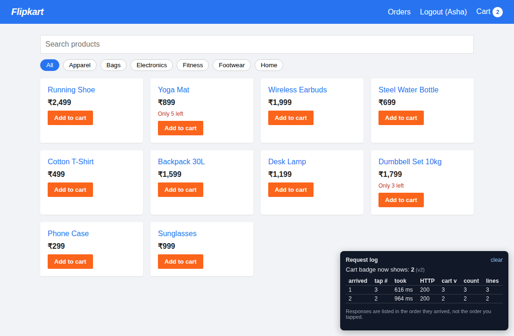
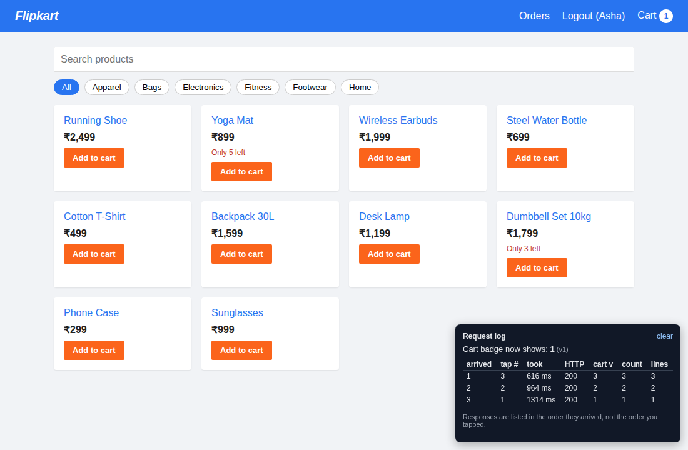
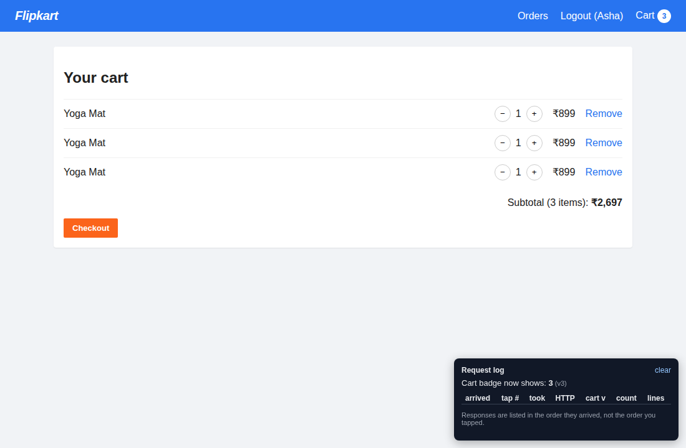
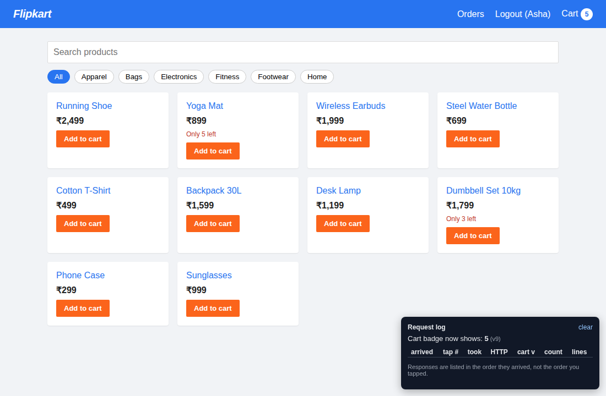
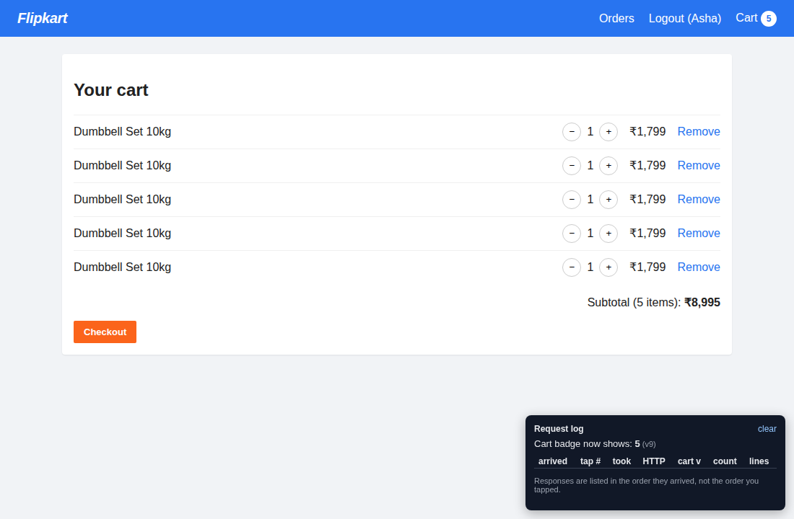
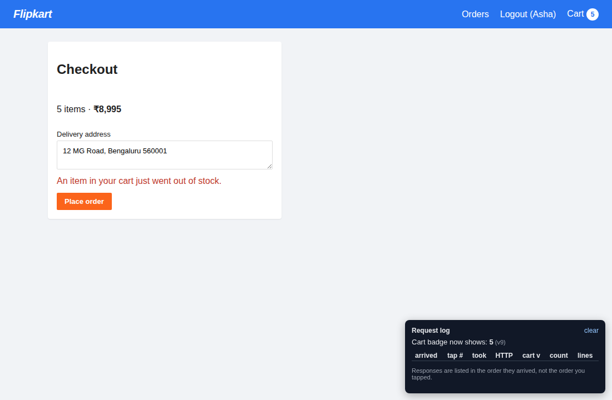

# Flipkart-lite: Cart Debugging Lab

A small but realistic shop (React + Express + SQLite) with login, a catalog, a cart, checkout and
order history. **The cart is broken.** Your job is to find out why and fix it, in every layer where
the problem lives.

> **Difficulty:** Hard · **Skills:** async/race conditions, React state, Express, SQLite constraints
> and transactions

---

## 1. Run it

```bash
npm install
npm run dev          # API on :3001, web app on http://localhost:5173
```

Open **http://localhost:5173/?debug=1**. The `?debug=1` adds a dark *Request log* panel in the
bottom-right corner that lists each "Add to cart" response in the order it **arrived**. The setting is
remembered in your browser, so the panel is still there after a refresh (on `/cart` the URL no longer has
`?debug=1`). Open `/?debug=0` to hide it again. The log itself starts empty after every refresh.

Log in with `asha@example.com` or `ravi@example.com`, password `password123`.

The database is **already included** (`data/shop.db`), so there is no setup or seeding step.
See [`database/README.md`](database/README.md) for what is in it.

---

## 2. What is broken

Support is getting tickets like this one:

> *"I tapped **Add to cart** on the Yoga Mat three times quickly. The cart number in the header said
> 3, then 2, then 1. I refreshed and now there are **three separate Yoga Mat lines** in my cart.
> Someone else says they ended up with more Dumbbells in their cart than the shop even has."*

There is no error in the console and every request returns HTTP 200. There are **three distinct
problems**. They look like one bug, but each one lives in a different layer and has a different fix.

### Problem 1: The cart badge shows the wrong number

Tap **Add to cart** on the **Yoga Mat** **exactly 3 times, as fast as you can**.

> Speed matters. If your taps are more than about a third of a second apart, the responses can come back in
> order and Problem 1 will not show. If that happens run `npm run reset`, refresh the page, log in again
> and retry, or use `npm run repro` (section 3), which is always exact.

| Right after the taps | A few seconds later |
|---|---|
|  |  |

Look at the *Request log*. The responses come back in the **wrong order**: tap 3's response arrives
first and tap 1's arrives last. The header ends on **1**, even though you tapped three times.

**Expected:** the badge settles on the true cart total (3), whatever order the responses arrive in.

> **Stuck?** Open [`docs/LAB.md`](docs/LAB.md) in a Markdown preview and read [Hint 1](docs/LAB.md#hint-1),
> then [Hint 5](docs/LAB.md#hint-5).

### Problem 2: After a refresh the cart has duplicate lines

Refresh the page and open the cart:



You tapped on one product, so there should be **one** Yoga Mat line with quantity **3**. Instead the cart
contains **three** lines of quantity 1. The database shows the same thing (`npm run db:inspect`):

```
cart_items  (one row per product per cart is what we expect)
┌─────────┬────┬────────────────────┬────────────┬────────────┬──────────┬───────┐
│ (index) │ id │ user               │ product_id │ name       │ quantity │ stock │
├─────────┼────┼────────────────────┼────────────┼────────────┼──────────┼───────┤
│ 0       │ 1  │ 'asha@example.com' │ 43         │ 'Yoga Mat' │ 1        │ 5     │
│ 1       │ 2  │ 'asha@example.com' │ 43         │ 'Yoga Mat' │ 1        │ 5     │
│ 2       │ 3  │ 'asha@example.com' │ 43         │ 'Yoga Mat' │ 1        │ 5     │
└─────────┴────┴────────────────────┴────────────┴────────────┴──────────┴───────┘
```

**Expected:** one line per product per cart, with the right quantity, in the UI **and** in the database.
Fixing only the UI is not enough: the stored data itself is wrong.

> **Stuck?** Open [`docs/LAB.md`](docs/LAB.md) in a Markdown preview and read [Hint 2](docs/LAB.md#hint-2),
> [Hint 3](docs/LAB.md#hint-3), [Hint 4](docs/LAB.md#hint-4) and [Hint 6](docs/LAB.md#hint-6), one at a time.

### Problem 3: The cart can hold more than is in stock (overselling)

The **Dumbbell Set** has only **3** in stock (the catalog says "Only 3 left"). Tap **Add to cart** on it
**exactly 5 times as fast as you can**, then refresh and look at the cart:

| Catalog | Cart | Checkout |
|---|---|---|
|  |  |  |

The cart now holds **5** dumbbells for a product with a stock of 3, and checkout fails with
*"An item in your cart just went out of stock"*, a nasty surprise for the customer.

**Expected:** at most 3 taps succeed. The rest must be rejected with HTTP `409 OUT_OF_STOCK`
(the UI already knows how to show that message).

> **Stuck?** Open [`docs/LAB.md`](docs/LAB.md) in a Markdown preview and read [Hint 3](docs/LAB.md#hint-3),
> then [Hint 6](docs/LAB.md#hint-6).

> The screenshots were taken with the untouched code. In the browser, how many extra items you
> end up with depends a little on how fast you tap. For an exact, repeatable result use
> `npm run repro` below.

### Good to know (these are not extra bugs)

- **+, − and Remove act on the whole product.** They call `PATCH` / `DELETE /api/cart/items/:productId`, which
  replace or delete *every* line of that product, not only the one you clicked. With the duplicate lines from
  Problem 2, pressing **+** on one line (1 to 2) collapses all three lines into a single line of 2, and the badge
  drops from 3 to 2. That is a knock-on effect of Problem 2: once there is one line per product these buttons
  behave as you would expect, so you do not need to change them.
- **A route that throws gets answered, it does not crash the server.** If the database rejects a duplicate row
  (for example after you add a unique constraint), the API replies `500 INTERNAL`, prints the error in the terminal
  running `npm run dev`, and keeps running. The page shows "Something went wrong. Please try again." A
  `SQLITE_CONSTRAINT_UNIQUE` message there is a clue, not a new bug.

---

## 3. Reproduce without clicking: `npm run repro`

Tapping fast enough to trigger problems 2 and 3 by hand depends on your speed. To get the same result
**every time**, run this in a second terminal while `npm run dev` is running:

```bash
npm run repro            # all three scenarios
npm run repro -- stale   # only problem 1   (also: dup, stock)
```

It sends a quick burst of "add to cart" requests (60 ms apart) and prints, for each response, the order it
arrived in, the cart `version`, and how many items and lines it contained. Then it shows what really ended
up in the database. After you fix the lab, every scenario should come out clean.

Each scenario starts by emptying the cart of the demo user it uses (Asha for problems 1 and 2, Ravi for problem 3),
so you can run it as often as you like. It also clears a cart you filled by hand for that user. The rows it creates
**stay in the database on purpose**: run `npm run db:inspect` straight afterwards to look at them (after a full run:
Asha's Yoga Mat lines and Ravi's Dumbbell Set lines), and `npm run reset` to start over. They also show up in the
web app's cart when you log in as that user.

### Why it is deterministic

The lab simulates a slow network and a slow internal pricing service with **fixed** delays (not random ones):

| What | Setting | Default |
|---|---|---|
| Time the API spends asking the pricing service about a product | `PRICING_MS` | `500` ms |
| Response delay for the 1st, 2nd, 3rd tap of a burst | `LATENCY=lab` | 800, 450, then 100 ms, so responses come back in reverse order every time |
| Random 40-450 ms latency per request (the old behaviour) | `LATENCY=random` | off |
| No artificial latency at all | `JITTER=off` | off |

Try `PRICING_MS=0 JITTER=off npm run dev:server`: the bugs vanish in the UI. That is exactly why bugs like
these slip through on a fast laptop and show up for real users on slow networks.

---

## 4. Your goal

Make rapid taps behave correctly **end to end**:

- [ ] The badge and the cart page always match the server, whatever order responses arrive in (problem 1)
- [ ] There is exactly **one** cart line per product, in the UI and in `cart_items` (problem 2)
- [ ] The cart can never hold more units of a product than its stock (problem 3)
- [ ] `npm test` passes (13 server tests and 2 client tests)
- [ ] `npm run repro` prints clean results for all three scenarios

Rules of the game: don't weaken the tests, and don't hide the symptom (for example by debouncing the
button), because a second browser tab or device would still break it.

Stuck? Hints are in [`docs/LAB.md`](docs/LAB.md), to be revealed one at a time.

---

## 5. Tests

```bash
npm test               # server (node:test) + client (vitest)
npm run test:server
npm run test:client
```

On the untouched code, 5 server tests and 1 client test fail:

| Failing test | Problem |
|---|---|
| client: `does not let a stale response overwrite a newer cart` | 1 |
| `three rapid adds of the same product give ONE line with quantity 3` | 2 |
| `rapid adds on top of an existing line do not lose increments` | 2 |
| `the database itself rejects duplicate (cart, product) lines` | 2 |
| `concurrent adds can never oversell the available stock` | 3 |
| `checkout charges exactly what the cart shows and decrements stock` | knock-on effect of 2 and 3 |

The other tests already pass. They guard behaviour that must keep working while you fix things, for example
`an unexpected error inside add-to-cart gives a 500 and the server keeps running`.

---

## 6. Project layout

```
server/      Express API: routes/ (cart.js is the interesting one), services/, middleware.js
client/      React app (Vite). Cart state lives in src/context/CartContext.jsx
database/    schema.sql + seed.sql: the static source of truth for the database
data/        shop.db: pre-built SQLite file, committed so it works out of the box
scripts/     repro.js (reproduce the bugs) and db.js (look inside the database)
tests/       API and concurrency tests
docs/        LAB.md (hints) and the screenshots used in this README
```

## 7. Handy commands

| Command | What it does |
|---|---|
| `npm run dev` | API on :3001 and web app on :5173 |
| `npm run repro` | Reproduce the three problems and show the result (the rows are kept so you can inspect them) |
| `npm run db:inspect` | Show cart rows, duplicate lines and carts |
| `npm run db:inspect -- "SELECT * FROM products"` | Run any read-only SQL query |
| `npm run reset` | Rebuild `data/shop.db` from `database/*.sql`. Works while the server is running; empties all carts and logs everyone out, so refresh the page and log in again |
| `npm test` | Run all tests |

If you change `database/schema.sql`, you don't need to remember to reset: the server notices on the next
start and rebuilds `data/shop.db` for you.

## 8. Troubleshooting

- **"I can't reproduce it."** Your taps were probably too slow (see Problem 1), or the cart still holds items from an
  earlier attempt. Run `npm run reset`, refresh the page, log in again, and retry with the exact number of taps. Or
  use `npm run repro`.
- **`npm run dev` stopped after I tapped.** The API crashed, and `npm run dev` stops the web app as well when either
  one dies. The error is printed just above the exit message. `npm run repro` reports "the connection was dropped"
  when this happens in the middle of a run.
- **`npm run repro` says it cannot reach the API.** Start `npm run dev` first (the API listens on port 3001).
- **There is no Request log panel.** Open `/?debug=1` once; the browser remembers it. `/?debug=0` hides it again.
