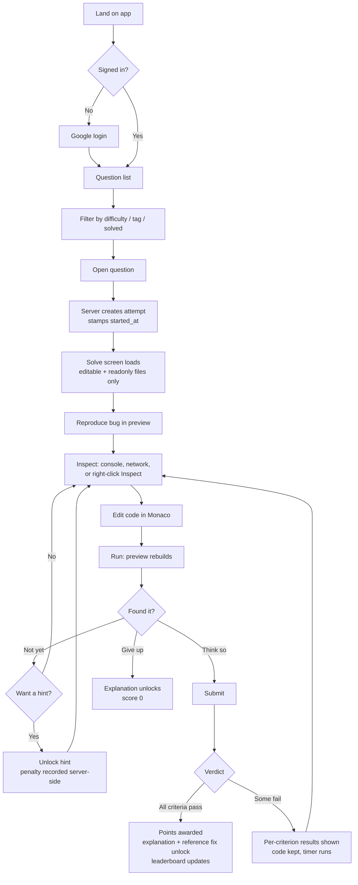
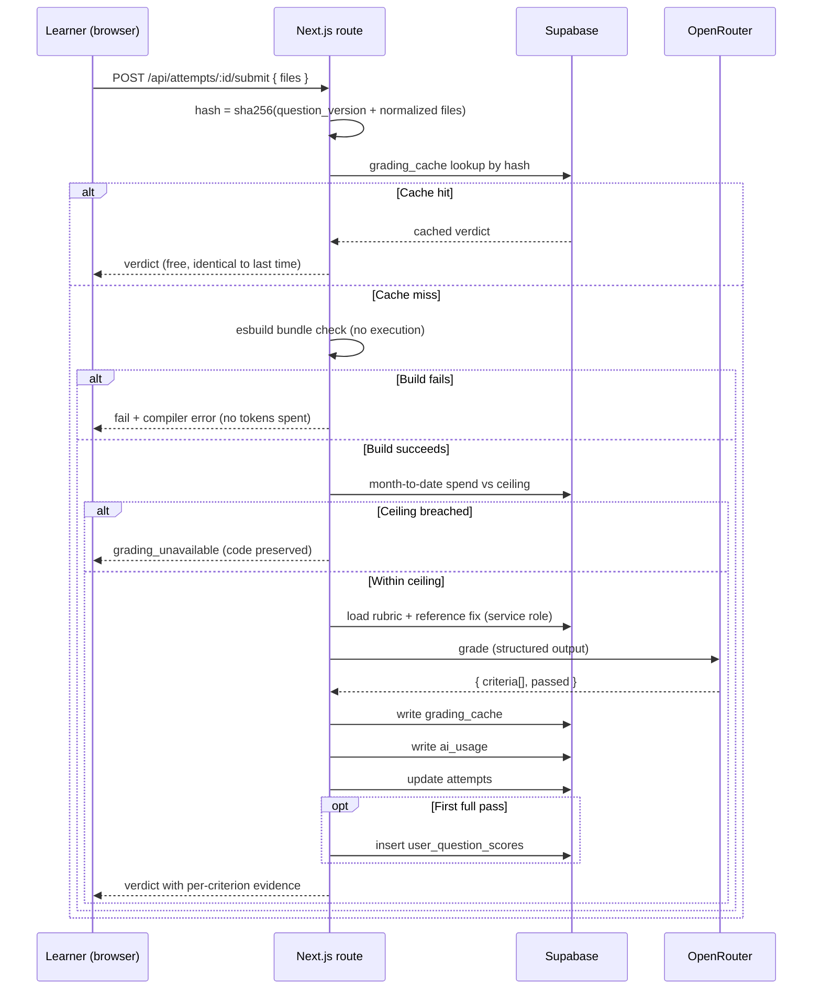
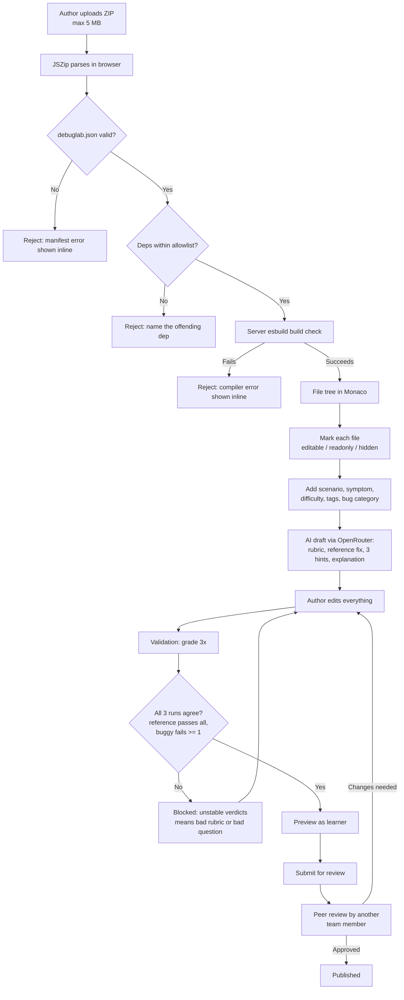
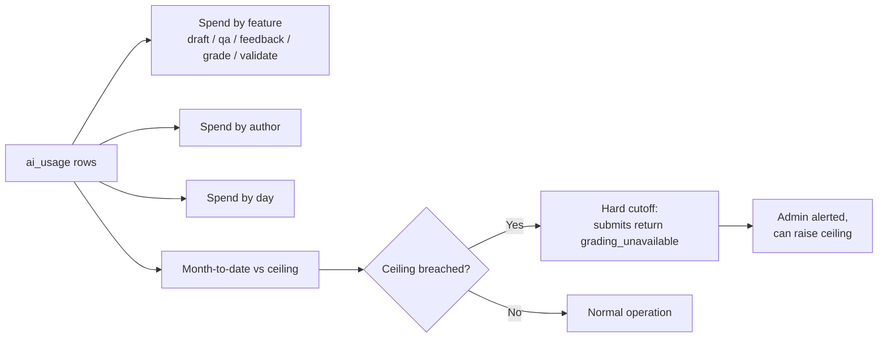
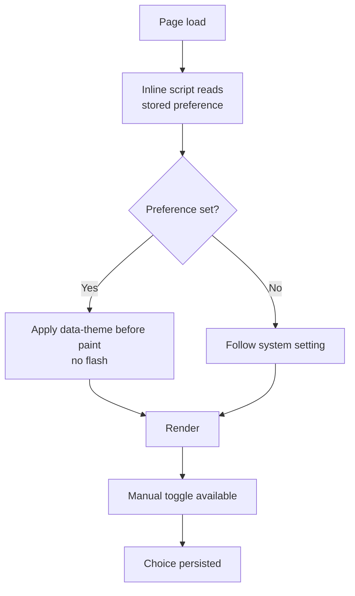

# User flows — Debugging Lab P1

Status: **awaiting approval**. Companion to [architecture.md](architecture.md).

---

## 1. Learner: pick a question and solve it

Only the **first** full pass writes a score row. Later submits still run, so a
learner can keep improving a solution, but the score does not change.

## 2. Submit: what happens server-side

Three gates stand before any token is spent: the cache, the build check, and the
spend ceiling.

## 3. Author: ZIP to published question

Rejections happen at upload, not after the author has written a whole question.

## 4. Admin: cost centre

## 5. Theme and loading behaviour

Applies to every screen above.

Every click, navigation, modal open and async call shows a loader; the triggering
control disables while busy. Submit is the longest wait in the product — it shows
progress through its stages (checking build → grading) rather than a bare spinner.
